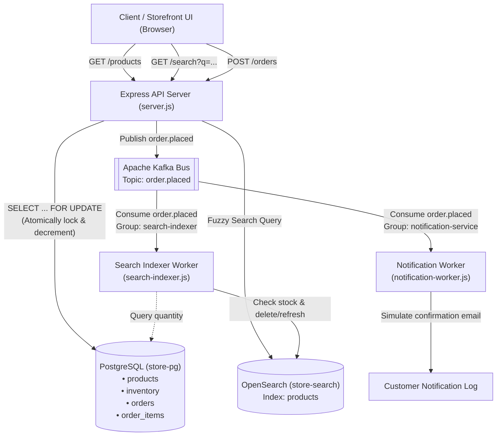

# Inventory Hub - Architecture & Design Document

## 1. System Overview

**Inventory Hub** is an event-driven, high-concurrency e-commerce order and inventory management system designed to eliminate race conditions (overselling) while providing real-time search indexing and asynchronous event processing.

The system is powered by three cloud services provisioned on Aiven:
1. **PostgreSQL**: System of record managing product catalogs, transactional orders, and authoritative inventory levels with ACID guarantees and row-level locking.
2. **Apache Kafka**: Distributed event bus propagating order lifecycle events (`order.placed`) asynchronously to decoupled worker services.
3. **OpenSearch**: High-performance, typo-tolerant search engine maintaining an index of currently in-stock products.

---

## 2. High-Level Architecture Diagram



---

## 3. Database Schema (PostgreSQL)

```sql
CREATE TABLE products (
  id SERIAL PRIMARY KEY,
  name TEXT NOT NULL,
  description TEXT,
  price NUMERIC(10,2) NOT NULL
);

CREATE TABLE inventory (
  product_id INT PRIMARY KEY REFERENCES products(id),
  quantity INT NOT NULL CHECK (quantity >= 0)
);

CREATE TABLE orders (
  id SERIAL PRIMARY KEY,
  customer_email TEXT NOT NULL,
  status TEXT NOT NULL DEFAULT 'placed',
  created_at TIMESTAMP NOT NULL DEFAULT NOW()
);

CREATE TABLE order_items (
  id SERIAL PRIMARY KEY,
  order_id INT NOT NULL REFERENCES orders(id),
  product_id INT NOT NULL REFERENCES products(id),
  quantity INT NOT NULL CHECK (quantity > 0)
);
```

### Constraints & Invariants
- `CHECK (quantity >= 0)` on `inventory`: Ensures the database engine rejects any update that would drive stock below zero.
- `CHECK (quantity > 0)` on `order_items`: Guards against invalid zero or negative quantity orders.
- Foreign Key cascading: Maintains relational integrity across orders and catalog items.

---

## 4. Concurrency & Race Condition Prevention

### The Problem
When multiple users attempt to purchase the final unit of a product simultaneously (e.g., flash sales), standard `SELECT quantity` followed by `UPDATE quantity` encounters a **Time-of-Check to Time-of-Use (TOCTOU)** race condition. Both requests observe `quantity = 1` and proceed to decrement, resulting in negative inventory or overselling.

### The Solution: Row-Level Locking with `FOR UPDATE`
In `server.js`, order placement executes inside an explicit database transaction:

```javascript
await client.query('BEGIN');

const stock = await client.query(
  'SELECT quantity FROM inventory WHERE product_id = $1 FOR UPDATE',
  [productId]
);

if (stock.rows[0].quantity < quantity) {
  await client.query('ROLLBACK');
  return res.status(409).json({ error: 'Not enough stock' });
}

await client.query(
  'UPDATE inventory SET quantity = quantity - $1 WHERE product_id = $2',
  [quantity, productId]
);

// Insert into orders and order_items...
await client.query('COMMIT');
```

1. **Exclusive Lock**: `SELECT ... FOR UPDATE` acquires an exclusive row lock on the specific inventory row for `productId`.
2. **Serialization**: Any competing concurrent requests attempting to purchase the same product block at the `SELECT` until the active transaction commits or rolls back.
3. **Deterministic Outcome**: The first transaction evaluates stock `1 >= 1`, decrements stock to `0`, commits, and releases the lock. The second transaction immediately wakes up, reads `0`, fails the check, rolls back, and receives an HTTP `409 Conflict`.

---

## 5. Event-Driven Architecture (Apache Kafka)

After a transaction successfully commits in PostgreSQL, an event is emitted to the Kafka topic:

- **Topic**: `order.placed`
- **Key**: `orderId` (string)
- **Payload**:
  ```json
  {
    "orderId": 105,
    "email": "user@example.com",
    "productId": 2,
    "quantity": 1
  }
  ```

### Consumer Groups
1. **`notification-service` (`notification-worker.js`)**:
   - Independently consumes orders.
   - Formats customer order details and prints simulated transactional confirmation emails.
2. **`search-indexer` (`search-indexer.js`)**:
   - Reads the newly placed order.
   - Queries the current stock of `productId` in PostgreSQL.
   - If `quantity <= 0`: Removes the product from OpenSearch index (`DELETE /products/_doc/{id}`).
   - If `quantity > 0`: Re-indexes the updated product metadata.

---

## 6. Search Service (OpenSearch)

- **Index Name**: `products`
- **Fuzzy Search**: Configured with `fuzziness: "AUTO"` over fields `['name^2', 'description']`.
- **Dynamic Invalidation**: Sold-out products are evicted from the OpenSearch index immediately via `search-indexer`. Customers searching for items will never see or purchase products that are out of stock.

