# Inventory Hub — Architecture & Design Document

## 1. System Overview

**Inventory Hub** is an event-driven, high-concurrency retail store system designed for retail chains in India. It eliminates overselling during high-concurrency flash sales while providing instant typo-tolerant product discovery, asynchronous order fulfillment, live order tracking, and real-time inventory streaming.

The system is powered by three cloud services provisioned on **Aiven**:
1. **PostgreSQL**: System of record for products, inventory levels, customers, orders, ledger audit trails, and the transactional outbox table with strict ACID row-level locking (`SELECT ... FOR UPDATE`).
2. **Apache Kafka**: High-throughput distributed event bus propagating domain events (`order.placed`, `inventory.updated`, `notification.requested`, `product.changed`) to decoupled worker services. All consumers implement idempotent processing via `processed_events`. (Strictly <= 5 topics to respect Aiven Free-Tier limits).
3. **OpenSearch**: Typo-tolerant search index (`products`) supporting fuzzy matching (e.g., "bluetoth", "speeker"), multilingual synonyms (e.g., "doodh" -> milk, "chappal" -> footwear), multi-attribute facets, and dynamic sold-out exclusion.

---

## 2. High-Level Architecture Diagram

```mermaid
flowchart TD
    Client["Storefront UI (Next.js 16 / Port 3000)"]
    API["Express API Server (Port 4000)"]
    
    subgraph Aiven_PostgreSQL ["Aiven PostgreSQL (Source of Truth)"]
        DB_Products["products"]
        DB_Inventory["inventory (stock_count, reserved_count)"]
        DB_Orders["orders (PLACED -> CONFIRMED)"]
        DB_Items["order_items"]
        DB_Outbox["outbox_events (Transactional Outbox)"]
        DB_Ledger["ledger_entries (Audit Trail)"]
        DB_Processed["processed_events (Idempotency Guard)"]
        DB_DeadLetter["dead_letter_events (DLQ Table)"]
    end

    subgraph Aiven_Kafka ["Aiven Apache Kafka (<= 5 Topics)"]
        T_OrderPlaced[["order.placed"]]
        T_InvUpdated[["inventory.updated"]]
        T_NotifReq[["notification.requested"]]
        T_ProdChanged[["product.changed"]]
    end

    subgraph Aiven_OpenSearch ["Aiven OpenSearch"]
        OS_Products[("Index: products_v1 / Alias: products\nFuzzy search & Facets")]
    end

    subgraph Background_Workers ["Asynchronous Background Workers"]
        OutboxPub["Outbox Publisher"]
        InvWorker["Inventory Worker"]
        NotifWorker["Notification Worker"]
        SearchIdx["Search Indexer Worker"]
    end

    %% Client flows
    Client -->|"GET /api/search?q=..."| API
    Client -->|"POST /api/orders (idempotent)"| API
    Client -->|"GET /api/stock/stream (SSE)"| API
    Client -->|"GET /api/orders/:id (Polling)"| API
    
    %% API to DB & OS
    API -->|"SELECT ... FOR UPDATE\n(Atomically reserve stock & write outbox)"| Aiven_PostgreSQL
    API -->|"Fuzzy query with synonyms"| OS_Products
    
    %% Workers
    DB_Outbox -->|"Poll unpublished events"| OutboxPub
    OutboxPub -->|"Publish events"| Aiven_Kafka
    
    T_OrderPlaced -->|"Consume"| InvWorker
    InvWorker -->|"Deduct stock & mark CONFIRMED"| Aiven_PostgreSQL
    InvWorker -->|"Produce inventory.updated & notification.requested"| DB_Outbox
    
    T_NotifReq -->|"Consume"| NotifWorker
    NotifWorker -->|"Record notification"| Aiven_PostgreSQL
    
    T_InvUpdated -->|"Consume"| SearchIdx
    T_ProdChanged -->|"Consume"| SearchIdx
    SearchIdx -->|"Update stock & in_stock flag"| OS_Products

    T_InvUpdated -.->|"Broadcast via SSE"| API
```



---

## 3. Database Schema (PostgreSQL)

```sql
-- Catalog & Products
CREATE TABLE products (
  id SERIAL PRIMARY KEY,
  sku VARCHAR(64) UNIQUE NOT NULL,
  name VARCHAR(255) NOT NULL,
  description TEXT,
  category VARCHAR(64) NOT NULL,
  city VARCHAR(64) NOT NULL,
  price_cents INT NOT NULL,
  currency VARCHAR(3) NOT NULL DEFAULT 'INR',
  image_url TEXT,
  rating NUMERIC(3,2) DEFAULT 4.5,
  delivery_time_mins INT DEFAULT 30,
  delivery_fee INT DEFAULT 49,
  distance_km NUMERIC(5,2) DEFAULT 3.5,
  tags TEXT[] DEFAULT '{}',
  expiry_date DATE NULL,
  is_active BOOLEAN NOT NULL DEFAULT TRUE,
  created_at TIMESTAMP NOT NULL DEFAULT NOW(),
  updated_at TIMESTAMP NOT NULL DEFAULT NOW()
);

-- Inventory with Reservation Support
CREATE TABLE inventory (
  product_id INT PRIMARY KEY REFERENCES products(id) ON DELETE CASCADE,
  stock_count INT NOT NULL CHECK (stock_count >= 0),
  reserved_count INT NOT NULL DEFAULT 0 CHECK (reserved_count >= 0),
  updated_at TIMESTAMP NOT NULL DEFAULT NOW()
);

-- Customers & Authentication
CREATE TABLE customers (
  id SERIAL PRIMARY KEY,
  email VARCHAR(255) UNIQUE NOT NULL,
  name VARCHAR(255),
  password_hash VARCHAR(255) NULL,
  city VARCHAR(64) NOT NULL DEFAULT 'Bengaluru',
  lat DOUBLE PRECISION NOT NULL DEFAULT 12.9716,
  lng DOUBLE PRECISION NOT NULL DEFAULT 77.5946,
  created_at TIMESTAMP NOT NULL DEFAULT NOW()
);

-- Orders
CREATE TABLE orders (
  id UUID PRIMARY KEY,
  customer_id INT NULL REFERENCES customers(id),
  customer_email VARCHAR(255),
  customer_name VARCHAR(255),
  status VARCHAR(32) NOT NULL DEFAULT 'PLACED',
  idempotency_key VARCHAR(255) UNIQUE NOT NULL,
  total_cents INT NOT NULL,
  currency VARCHAR(3) NOT NULL DEFAULT 'INR',
  created_at TIMESTAMP NOT NULL DEFAULT NOW(),
  updated_at TIMESTAMP NOT NULL DEFAULT NOW()
);

-- Order Items
CREATE TABLE order_items (
  id SERIAL PRIMARY KEY,
  order_id UUID NOT NULL REFERENCES orders(id) ON DELETE CASCADE,
  product_id INT NOT NULL REFERENCES products(id),
  quantity INT NOT NULL CHECK (quantity > 0),
  price_cents INT NOT NULL
);

-- Transactional Outbox Pattern
CREATE TABLE outbox_events (
  id SERIAL PRIMARY KEY,
  topic VARCHAR(128) NOT NULL,
  event_key VARCHAR(255) NOT NULL,
  payload JSONB NOT NULL,
  created_at TIMESTAMP NOT NULL DEFAULT NOW(),
  published_at TIMESTAMP NULL
);

-- Inventory Ledger (Audit Trail)
CREATE TABLE ledger_entries (
  id SERIAL PRIMARY KEY,
  product_id INT NOT NULL REFERENCES products(id),
  order_id UUID NOT NULL REFERENCES orders(id),
  entry_type VARCHAR(32) NOT NULL,
  quantity INT NOT NULL,
  created_at TIMESTAMP NOT NULL DEFAULT NOW()
);

-- Idempotency Guard for Consumers
CREATE TABLE processed_events (
  event_id VARCHAR(128) NOT NULL,
  consumer_name VARCHAR(64) NOT NULL,
  processed_at TIMESTAMP NOT NULL DEFAULT NOW(),
  PRIMARY KEY (event_id, consumer_name)
);

-- Dead Letter Events (In-DB storage avoiding Kafka topic limits)
CREATE TABLE dead_letter_events (
  id SERIAL PRIMARY KEY,
  topic VARCHAR(128) NOT NULL,
  event_key VARCHAR(255),
  payload JSONB NOT NULL,
  error TEXT,
  created_at TIMESTAMP NOT NULL DEFAULT NOW()
);
```

---

## 4. Kafka Topics & Event Schemas

To comply with **Aiven Free-Tier limits (<= 5 topics)**, exactly 4 domain topics are utilized. Dead-letters are captured in PostgreSQL `dead_letter_events` table instead of standalone `.dlq` topics.

| Topic Name | Purpose | Partitions | Producer | Consumers |
| :--- | :--- | :---: | :--- | :--- |
| `order.placed` | New order created and stock reserved | 1 | Outbox Publisher | `inventory-worker` |
| `inventory.updated` | Inventory committed or changed | 1 | Outbox Publisher | `search-indexer`, `sse-stock-broadcaster` |
| `notification.requested`| Customer email requested | 1 | Outbox Publisher | `notification-worker` |
| `product.changed` | Admin catalog updates/deletions | 1 | Outbox Publisher | `search-indexer` |

### Event Payload Structure (Standard Envelope)

```json
{
  "eventId": "1efaef77-857f-4a94-ab53-8b4de314f112",
  "eventType": "order.placed",
  "schemaVersion": "1.0.0",
  "occurredAt": "2026-11-21T19:55:31.763Z",
  "source": "inventory-hub-backend",
  "correlationId": "1efaef77-857f-4a94-ab53-8b4de314f112",
  "data": {
    "orderId": "1efaef77-857f-4a94-ab53-8b4de314f112",
    "customerEmail": "customer@example.com",
    "customerName": "Customer Name",
    "totalCents": 149900,
    "items": [
      {
        "productId": 1,
        "productName": "Bluetooth Speaker",
        "quantity": 1,
        "priceCents": 149900
      }
    ]
  }
}
```

---

## 5. Concurrency & Race Condition Prevention

### The Problem
During flash sales, multiple shoppers submit orders simultaneously for the final remaining inventory unit. Naive implementations read `stock = 1`, conclude availability, and decrement, causing negative stock and overselling.

### The Solution: Row-Level Locking with `FOR UPDATE`
In `POST /api/orders`:
1. Order items are sorted ascending by `product_id` to prevent deadlock between concurrent multi-item carts.
2. An explicit database transaction locks the exact inventory rows:
   ```sql
   SELECT p.id, p.name, p.price_cents, p.expiry_date, p.is_active, i.stock_count, i.reserved_count 
   FROM products p 
   JOIN inventory i ON i.product_id = p.id 
   WHERE p.id = ANY($1::int[]) 
   ORDER BY p.id ASC 
   FOR UPDATE OF i;
   ```
3. Available units are checked: `available = stock_count - reserved_count`.
4. If `available < quantity` or the product is expired, the transaction rolls back immediately and returns **409 Conflict** with message `"Item is expired or out of stock"`.
5. If valid, `reserved_count` is incremented, the order is created with status `PLACED`, and an event is written to `outbox_events` in the **same transaction**.
6. Concurrency tests with 50 simultaneous requests against 1 unit prove:
   - Exactly **1 request receives 201 Created**.
   - Exactly **49 requests receive 409 Conflict**.
   - Stock remains at 0, never negative.

---

## 6. OpenSearch Real-Time Sync & Typo Tolerance

1. **Typo Tolerance**: Queries use multi-match fuzzy search (`fuzziness: 'AUTO'`, `prefix_length: 1`) on `name`, `description`, `category`, and `tags`, coupled with pre-query synonym expansion (mapping "bluetoth" -> "bluetooth", "speeker" -> "speaker", "doodh" -> "milk").
2. **Dynamic In-Stock Filtering**: Queries enforce `in_stock: true` and `is_active: true`.
3. **Instant Zero-Stock Exclusion**: When `inventory.updated` is consumed, the index document is updated in real time. When stock hits 0, `in_stock` becomes `false`, causing the item to disappear from search results immediately.
